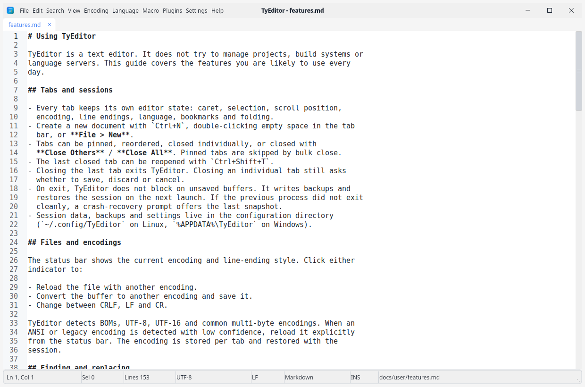

<p align="center"></p>

# TyEditor

**A focused, cross-platform text editor built with Lazarus/Free Pascal.**

TyEditor is a native desktop text editor for Linux, Windows and macOS. It keeps
the familiar habits of a classic editor: tabs, sessions, encodings, search,
macros, bookmarks and syntax highlighting. It is deliberately **not an IDE** —
there is no LSP, terminal, debugger, project workspace, Git integration or code
intelligence.

[English](README.md) · [简体中文](README.zh_CN.md)

<p align="center"></p>

## Highlights

- **Native and fast** — Lazarus/LCL with TyControls; Linux uses Qt6, Windows
  uses the native Win32 widgetset, macOS uses Cocoa.
- **Your work survives restarts** — restores tabs, carets, selections, scroll
  positions, encoding/EOL, language, bookmarks and folding; unsaved buffers are
  backed up and crash recovery is offered on the next launch.
- **Encoding-aware** — UTF-8/16/32 with BOM detection, ANSI code pages, GBK,
  Big5, Shift-JIS, EUC-KR and more; convert or reload from the status bar.
- **Search that stays responsive** — find/replace with regex, case, whole-word
  and selection modes; asynchronous find/replace in files with progress,
  cancellation and export.
- **A text editor’s editing model** — multi-caret and column editing, line
  operations, comment toggle, bracket matching, macros and bookmarks.
- **58 built-in syntax lexers** — 19 EControl lexers plus 39 TyEditor language
  definitions, selected automatically by extension. Highlighting is lexical:
  keywords, types, constants, strings, comments, numbers and operators.
- **Installable plugins v1** — `.typlugin` packages with their own manifest,
  commands, options and translations. Process and PascalScript runtimes share a
  JSON request/response boundary; install, enable, reload and uninstall from the
  plugin manager.
- **External tools** — configure your own commands under **Tools > Manage
  Tools...**. Tools receive the selection or document on standard input, write
  to standard output, support placeholders such as `${file}` and `${line}`, and
  run in the background with cancellation and timeout. They stay separate from
  plugins.
- **Readable for long sessions** — seven editor color schemes with light/dark
  palettes, TyControls interface themes, minimap/micromap, line numbers, ruler,
  whitespace display and a read-only document map (`F8`).
- **Desktop integration** — single-instance command-line opening, drag and drop,
  Linux desktop entry, Windows installer with optional `.txt` association, and
  a macOS app bundle.

## Quick start

### Build from source

You need Lazarus with FPC, TyControls, ATSynEdit, ATSynEdit_Ex, EControl,
EncConv and the PascalScript component package. On Linux, install the Qt6
development libraries as well.

```bash
git clone https://github.com/ACTom/TyEditor.git
cd TyEditor
cp scripts/env.example.sh scripts/env.local.sh
# Edit scripts/env.local.sh for your lazbuild, TyControls and CCR paths.
./scripts/build.sh
```

The default target is Linux x86_64 with Qt6, and the binary is written to
`dist/linux-x86_64/TyEditor`. Other targets include `linux-aarch64`, `win32`,
`win64`, `macos` and `all`.

See [Building and installing](docs/user/installing.md) for the full setup,
cross-compilation notes and packaging commands.

### Run

```bash
dist/linux-x86_64/TyEditor
dist/linux-x86_64/TyEditor file1.txt file2.md
```

On first launch TyEditor creates its settings and session directory:

| Platform | Configuration directory |
| --- | --- |
| Linux | `~/.config/TyEditor/` |
| Windows | `%APPDATA%\TyEditor\` |
| macOS | `~/Library/Application Support/TyEditor/` |

## Documentation

| Guide | What it covers |
| --- | --- |
| [Installing and building](docs/user/installing.md) | Dependencies, build targets, packaging and desktop installation |
| [Using TyEditor](docs/user/features.md) | Sessions, encodings, search, editing, views and settings |
| [Languages and syntax](docs/user/languages.md) | All built-in lexers, extensions and limitations |
| [Plugins](docs/user/plugins.md) | Installing, using and writing plugins |
| [External tools](docs/user/tools.md) | Configuring commands that operate on the current document |
| [Keyboard shortcuts](docs/user/shortcuts.md) | Menu shortcuts and common editing keys |
| [Architecture](docs/dev/ARCHITECTURE.md) | Source layout and extension points |
| [Build and release workflow](docs/dev/BUILDING.md) | Script flow, cross builds and release checks |
| [Plugin protocol](docs/dev/PLUGIN_PROTOCOL.md) | Package format, manifest, runtimes and JSON protocol |
| [Testing](docs/dev/TESTING.md) | Automated tests and manual acceptance checklist |
| [Roadmap](docs/dev/ROADMAP.md) | Current scope and planned work |

## Plugins

TyEditor v1 plugins are installable `.typlugin` packages: ZIP archives with a
root `plugin.json`, optional `locales/` translations and the plugin's scripts or
executables. Packages declare their own ID, version, editor/platform
compatibility, runtime, permissions, commands and options. User plugins override
bundled plugins with the same ID.

Bundled samples live in `data/plugins/`:

- **Base64 Tools** — encode or decode the current selection.
- **Text Tools** — uppercase, lowercase, title case, or trim trailing spaces.
- **Caesar Cipher** — demo encryption/decryption (shift 3, not secure).
- **JSON Formatter** — format or minify JSON with indent/sort options.
- **External Formatter** — run `clang-format` on a selection or document.

All five samples are Python 3 process plugins and currently declare Linux
support only, so Windows and macOS show them as disabled with a platform reason.
External Formatter also needs `clang-format`. The PascalScript runtime is
embedded and needs no external interpreter.

Use **Plugins > Manage Plugins...** to install a package, enable or disable it,
reload, open the user plugin directory or uninstall it. The manager keeps state
in `plugins.json`; incompatible packages remain visible but disabled with a
reason. Plugin execution runs in the background with timeout and cancellation.
Each package owns its translations, resolved through exact locale, base
language, default locale and English.

Read [docs/user/plugins.md](docs/user/plugins.md) to install and use plugins, or
[docs/dev/PLUGIN_PROTOCOL.md](docs/dev/PLUGIN_PROTOCOL.md) to build one.

## External tools

External tools are plain commands you configure yourself; they are not plugins
and are not installed from `.typlugin` packages. Open **Tools > Manage Tools...**
to add a command, choose what it receives on standard input (nothing, the
selection or the whole document), choose where its output goes, and set a
timeout. Arguments are one per line and never go through a shell. Placeholders
such as `${file}`, `${dir}`, `${line}`, `${col}`, `${lexer}` and `${inputfile}`
connect the command to the current document.

Enabled tools appear directly in the **Tools** menu. Execution runs in the
background with a Cancel button; non-zero exit codes, timeouts and missing
commands are reported with their standard error output. Definitions are stored
in `tools.json` in the configuration directory.

Read [docs/user/tools.md](docs/user/tools.md) for every option and examples.

## Scope

TyEditor focuses on being a good text editor:

- No language server, completion engine or diagnostics panel.
- No integrated terminal, debugger or project task runner.
- No project/workspace model or Git integration.
- No editable split view; `F8` opens a read-only document map only.

## License

TyEditor is licensed under the [Apache License 2.0](LICENSE). Third-party
components and data remain under their own licenses; see
[THIRD_PARTY_NOTICES.md](THIRD_PARTY_NOTICES.md) and [NOTICE](NOTICE).
